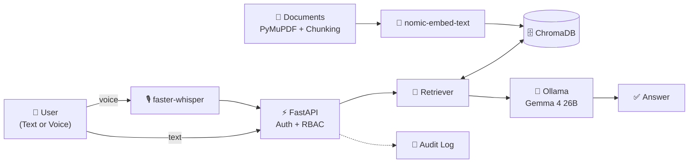
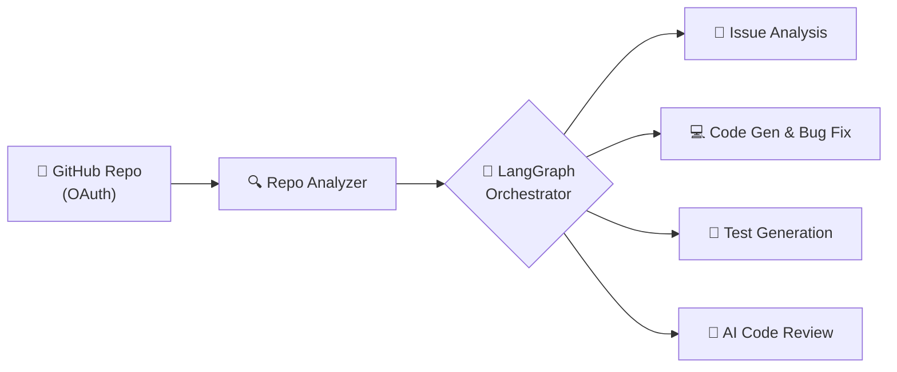

<!-- ====================================================== -->
<!--                        HEADER                          -->
<!-- ====================================================== -->

<div align="center">


<a href="https://github.com/Shubham123-k">

</a>

<br/><br/>


<br/><br/>

<!-- QUICK NAVIGATION -->
<a href="#about"></a>
<a href="#expertise"></a>
<a href="#stack"></a>
<a href="#projects"></a>
<a href="#analytics"></a>
<a href="#dsa"></a>
<a href="#connect"></a>

</div>

<br/>

<!-- ====================================================== -->
<!--                         ABOUT                          -->
<!-- ====================================================== -->

<a id="about"></a>

## 👋 &nbsp;Hello, World — I'm Shubham

> I don't just build applications — I study the problem, design the architecture, and ship solutions that survive the real world.

I'm a **Computer Science Engineering student**, **Full Stack Developer** and **AI engineer-in-the-making**, working at the intersection of **software engineering, artificial intelligence and problem solving**.

```ts
const shubham = {
  name:         "Shubham Bind",
  role:         ["Full Stack Developer", "AI & LLM Application Developer"],
  education:    "B.Tech — Computer Science & Engineering",
  internship:   "DRDO (ARDE) — Offline AI Vulnerability Assessment & Knowledge Assistant",
  languages:    ["Java", "JavaScript", "Python", "C++"],
  building:     ["RAG Systems", "AI Agents", "Production-ready Web Apps"],
  practicing:   "Data Structures & Algorithms, daily",
  lookingFor:   "Software Engineer / AI Engineer opportunities",
  motto:        "Think Deeply. Build Intelligently. Engineer What's Next.",
};
```

<br/>

<div align="center">

| 🎓 **Education** | 🔬 **Internship** | 🤖 **Focus** | 🚀 **Projects** |
|:---:|:---:|:---:|:---:|
| B.Tech CSE | DRDO — ARDE | LLMs · RAG · Agents | 6 featured builds |

</div>

<br/>

<!-- ====================================================== -->
<!--                       EXPERTISE                        -->
<!-- ====================================================== -->

<a id="expertise"></a>

## ⚡ &nbsp;What I Do

<table>
<tr>
<td width="50%" valign="top">

#### 🌐 Full Stack Development
`Responsive UI/UX` `REST APIs` `Auth & Authorization` `Database Design` `Scalable Architecture`

Modern frontend architecture paired with robust, well-modelled backends.

</td>
<td width="50%" valign="top">

#### 🤖 AI Engineering
`RAG` `LLMs` `AI Agents` `Embeddings` `Vector DBs` `Prompt Engineering` `Offline AI`

Agentic workflows, semantic search and local-first AI systems.

</td>
</tr>
<tr>
<td width="50%" valign="top">

#### 🧠 Problem Solving
`DSA` `OOP` `Algorithm Optimization` `Competitive Programming`

Logical thinking and efficient solutions, practiced consistently.

</td>
<td width="50%" valign="top">

#### ⚙️ Software Engineering
`Backend` `System Architecture` `Git Workflows` `API Integrations` `App Security` `Deployment`

Clean, secure and maintainable software from commit to production.

</td>
</tr>
</table>

<br/>

<!-- ====================================================== -->
<!--                       TECH STACK                       -->
<!-- ====================================================== -->

<a id="stack"></a>

## 🛠️ &nbsp;Tech Arsenal

<div align="center">

| | |
|:---|:---|
| **💻 Languages** |  |
| **🎨 Frontend** |  |
| **⚙️ Backend** |  |
| **🗄️ Databases** |  |
| **🧠 ML / AI** |  |
| **☁️ Cloud & DevOps** |  |
| **🔧 Dev Tools** |  |

</div>

<details>
<summary><b>🤖 &nbsp;Generative AI & LLM Toolkit</b> &nbsp;<i>(click to expand)</i></summary>

<br/>

<div align="center">


<br/>


</div>

<br/>

**Concepts:** `Embedding Models` `Vector Databases` `Semantic Search` `Document Chunking & Retrieval` `Context Engineering` `Agent Orchestration` `Multi-Agent Systems` `Local LLM Deployment` `Offline AI Apps` `Speech Recognition (faster-whisper)`

</details>

<details>
<summary><b>⚙️ &nbsp;Backend, Database & Platform Details</b> &nbsp;<i>(click to expand)</i></summary>

<br/>

**Backend:** `RESTful APIs` `JWT Authentication` `OAuth 2.0` `Prisma ORM` `Mongoose` `Better Auth` `RBAC`

**Databases:** `Relational & NoSQL` `Data Modeling` `Query Optimization` `Indexing` `Vector Search` `Semantic Retrieval`

**Platforms:** `Vercel` `Render` `Neon PostgreSQL` `MongoDB Atlas` `Cloudinary` `GitHub Actions`

</details>

<br/>

<!-- ====================================================== -->
<!--                   FEATURED PROJECTS                    -->
<!-- ====================================================== -->

<a id="projects"></a>

## 🚀 &nbsp;Featured Projects

<!-- TIP: Add your repo/demo links under each project, e.g. [🔗 Repository](https://github.com/Shubham123-k/REPO-NAME) -->

### 🛡️ Flagship — Offline AI Defence Vulnerability Assessment & Knowledge Assistant


An **offline-first AI knowledge assistant** built during my internship at the **Defence Research and Development Organisation (DRDO) — ARDE**, designed for defence vulnerability assessment and secure document intelligence. It combines **local LLMs**, **Retrieval-Augmented Generation**, **document-level access control** and **CVE analysis** — with zero dependency on the cloud.



<table>
<tr>
<td width="50%" valign="top">

**🧠 Intelligence**
- Fully local & offline LLM inference
- RAG-based document Q&A
- Document ingestion & semantic retrieval
- Defence vulnerability assessment
- CVE report analysis & explanation
- Offline voice interaction

</td>
<td width="50%" valign="top">

**🔐 Security**
- Role-based access control
- Public / Confidential / Secret classifications
- Encrypted document storage
- Document-level permissions
- Audit logging
- Restricted downloads & admin-controlled provisioning

</td>
</tr>
</table>

**Stack:** `Python` `FastAPI` `Ollama` `Gemma 4 26B` `LangChain` `RAG` `ChromaDB` `nomic-embed-text` `faster-whisper` `PyMuPDF` `Python Security Libraries`

<br/>

---

### 🧠 DevAgent — AI Software Engineering Agent


An AI assistant that **understands GitHub repositories** and supports developers across the whole software development lifecycle.



**Capabilities:** `Repository understanding` `Issue analysis` `Code generation & bug fixing` `Test generation` `AI code review` `Multi-agent orchestration`

**Stack:** `React` `FastAPI` `Python` `LangGraph` `LLMs` `GitHub OAuth`

<br/>

---

### 📦 More Builds

<table>
<tr>
<td width="50%" valign="top">

#### 🌐 Webro AI
**AI Website Generator**

Turns plain-English prompts into modern, responsive website experiences with full backend integration.

`AI generation` `Prompt-to-site` `Responsive UI` `DB-powered`


</td>
<td width="50%" valign="top">

#### 🛒 SwiftCart
**Smart E-Commerce Platform**

A modern storefront with a scalable backend and an AI-assisted shopping experience.

`Products` `Cart` `Authentication` `Database integration` `AI shopping`


</td>
</tr>
<tr>
<td width="50%" valign="top">

#### 🎨 ThumbnailX
**AI Thumbnail Generator**

Helps creators generate eye-catching thumbnails, with cloud image storage and user accounts.

`AI generation` `Image management` `Cloud storage` `Authentication`


</td>
<td width="50%" valign="top">

#### 🔐 PassOP
**Password Manager**

A clean app to securely organize and manage credentials with a simple, reliable CRUD workflow.

`Password management` `CRUD` `Credential organization`


</td>
</tr>
</table>

<br/>

<!-- ====================================================== -->
<!--                   GITHUB ANALYTICS                     -->
<!-- ====================================================== -->

<a id="analytics"></a>

## 📊 &nbsp;GitHub Analytics

<div align="center">


<br/><br/>


<br/><br/>


<br/><br/>


</div>

<br/>

<!-- ====================================================== -->
<!--                  COMPETITIVE PROGRAMMING               -->
<!-- ====================================================== -->

<a id="dsa"></a>

## 🧩 &nbsp;Competitive Programming

<div align="center">

<a href="https://leetcode.com/u/ShubhamK69/">

</a>
<a href="https://www.geeksforgeeks.org/profile/shubhamk1z07/">

</a>
<a href="https://www.hackerrank.com/profile/shubhamkbind69">

</a>

<br/><br/>


</div>

<br/>

<!-- ====================================================== -->
<!--                     CURRENT FOCUS                      -->
<!-- ====================================================== -->

## 🎯 &nbsp;Current Focus

<div align="center">

| # | Focus Area | Status |
|:-:|:--|:-:|
| 01 | Advanced Data Structures & Algorithms |  |
| 02 | Large Language Models & RAG Architectures |  |
| 03 | AI Agents & Multi-Agent Systems |  |
| 04 | Backend Engineering & System Design |  |
| 05 | Database Optimization |  |
| 06 | Production-Ready Applications |  |

</div>

<br/>

<!-- ====================================================== -->
<!--                       PHILOSOPHY                       -->
<!-- ====================================================== -->

## 💡 &nbsp;Developer Philosophy

<div align="center">

*Great software comes from curiosity, consistency and continuous improvement.*

</div>

```java
public class Developer {

    public static void main(String[] args) {

        while (true) {
            learn();
            build();
            solveProblems();
            improve();
        }
    }
}
```

<br/>

<!-- ====================================================== -->
<!--                        CONNECT                         -->
<!-- ====================================================== -->

<a id="connect"></a>

## 🌐 &nbsp;Let's Connect

<div align="center">

I'm always up for connecting with developers, collaborating on innovative projects, exploring AI and talking software engineering.

<br/><br/>

<a href="https://www.linkedin.com/in/shubham-bind-53305432b/">

</a>
<a href="https://github.com/Shubham123-k">

</a>
<a href="https://leetcode.com/u/ShubhamK69/">

</a>
<a href="https://www.geeksforgeeks.org/profile/shubhamk1z07/">

</a>

<br/><br/>

### ⭐ Thanks for stopping by!

**Code. Create. Innovate. Repeat.**

</div>

<!-- ====================================================== -->
<!--                        FOOTER                          -->
<!-- ====================================================== -->


